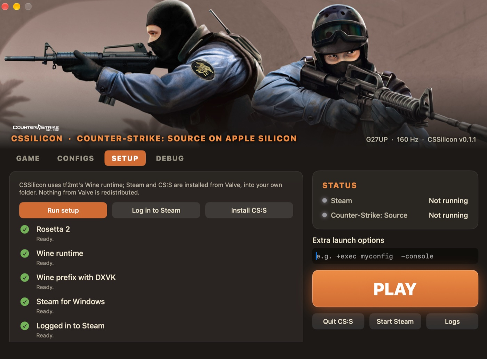
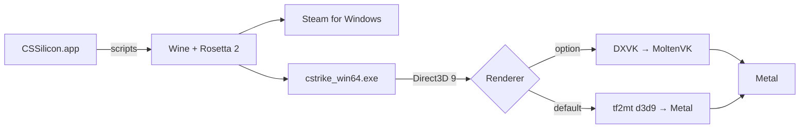

<!-- prettier-ignore -->
<div align="center">

# CSSilicon

**Play Counter-Strike: Source on Apple Silicon Macs — smooth, on VAC-secured servers, in one click.**


[](LICENSE)

[Overview](#overview) • [Getting started](#getting-started) • [Settings](#settings) • [How it works](#how-it-works) • [FAQ](#faq) • [Build from source](#build-from-source)


<br><sub>The game art in the header is read from your own Steam library cache; the app ships none.</sub>

</div>

Valve no longer ships a playable macOS build of Counter-Strike: Source. CSSilicon runs the official **Windows** version
of the game on your Mac — the one Steam servers expect — with a native Direct3D 9 → Metal renderer and a set of
measured fixes for smooth aim and stutter-free play. It is a fork of [tf2mt](https://github.com/HorrorPills/tf2mt),
which does the same for Team Fortress 2.

> [!NOTE]
> CSSilicon is a community project. It is not affiliated with or endorsed by Valve. Nothing from Valve is bundled:
> Steam and the game are downloaded from Valve into your own folder.

## Overview

CSSilicon is a small macOS app. It sets up a Wine environment, installs the Windows Steam client, downloads
Counter-Strike: Source with your own Steam account and launches it with settings that suit your Mac.

### Features

- **Official servers and community servers**: the real Windows game, so it joins any VAC-secured server.
- **Native Metal renderer**: Direct3D 9 is translated straight to Metal. No shader-compile hitches, and a pipeline
  cache that makes the next sessions start warm.
- **Adapts to your Mac**: runs at your display's own resolution and refresh rate by default; pick a lower resolution
  or a fixed refresh rate (120 Hz, 144 Hz…) for the session, and the display is put back when you quit.
- **Smooth mouse**: aim updates every frame (patched Wine mouse handling from tf2mt).
- **Graphics presets** (Low, Balanced, High): your own `autoexec.cfg` lines are kept and win over the preset.
- **Clean sessions**: Steam and Wine shut down when the game exits, however it exits.
- **Quality of life**: microphone picker, show/hide the Steam window, config folders, logs.

## Getting started

### Requirements

- A Mac with Apple Silicon (M1 or newer) and macOS 13 or later
- About 20 GB of free disk space
- A Steam account that owns Counter-Strike: Source

### Install

1. Download `CSSilicon-app.zip` from the [latest release](https://github.com/cmer81/cssilicon/releases/latest), unzip it
   and move **CSSilicon.app** to your Applications folder.
2. The app isn't signed by Apple: the first time, **right-click it → Open**, then confirm.
3. In the **Setup** tab, click **Run setup**. It installs Rosetta 2 if needed, a Wine runtime (~230 MB), DXVK and the
   Windows Steam client into `~/Games/css`.
4. Click **Log in to Steam** and sign in once (Steam Guard works as usual).
5. Click **Install CS:S** and let Steam download the game (about 6 GB).
6. Click **Play**.

> [!TIP]
> The **Native Metal Renderer** is on by default: no hitches the first time an effect shows up (a spawn, a knife, the
> flashlight), and usually more fps than DXVK. If a map looks wrong, turn it off in the **Game** tab to compare with DXVK.

## Settings

Everything lives in the launcher; you don't need the terminal.

| Tab | Setting | What it does |
|---|---|---|
| Game | **Native Metal Renderer** | Direct3D 9 → Metal (on by default). Turn it off to use DXVK |
| Game | **Resolution** | *Native* uses the display's size; lower sizes run faster on smaller GPUs |
| Game | **Refresh rate while playing** | *Unchanged*, or a rate your display offers (e.g. 120 Hz) for the session |
| Game | **Frame pacing** | Vsync (no tearing), uncapped, or an fps cap |
| Game | **Smooth mouse fix** | Every mouse movement reaches the game, at any refresh rate |
| Game | **Microphone** | Input device for voice chat |
| Game | **Steam Overlay** | In-game store and overlay (DXVK only) |
| Configs | **Graphics preset** | Low, Balanced (default) or High, or *None* to use only your own config |
| Debug | **Record frame times**, **Metal HUD**, **Load .exe** | Tools to measure and troubleshoot |

> [!TIP]
> Smaller Macs are mostly limited by the GPU. On a base M1 with a 1440p display, **1920x1080** at **120 Hz** with the
> Metal renderer and the Balanced preset is a good balance. Faster chips can keep the native resolution.

Measured on a MacBook Pro M1 (8-core GPU), busy Zombie Escape server, Balanced preset:

| | DXVK | Metal, 2560×1440 | Metal, 1920×1080 |
|---|---|---|---|
| Average fps | ~60 | 51–56 | 66–80 |
| Shader-compile hitches | yes | none | none |

## How it works



- The app is a SwiftUI launcher. All the work is done by the shell scripts in [`scripts/`](scripts), which you can
  also run from a terminal (`scripts/setup.sh`, `scripts/play.sh`).
- The Metal renderer is a `d3d9.dll` placed next to the game for the session only, and removed when it exits. The
  game files and its memory are never modified.
- Your data (Wine, Steam, the game, logs and caches) lives in `~/Games/css`.

## FAQ

<details>
<summary><b>Is it safe with VAC?</b></summary>

CSSilicon plays on VAC-secured servers, and no bans are known. It doesn't patch the game's files, inject code into the
game or touch its memory. What it does put in place:

- a `d3d9.dll` next to the game, for the session only, when the Metal renderer is on (removed when the game exits) —
  the same mechanism as DXVK, and as Proton on the Steam Deck;
- preset files in `cstrike/custom/cssmt` and one line in `cstrike/cfg/autoexec.cfg`.

Valve has never said anything about running the game this way, so use it at your own risk, as with any third-party
tool.
</details>

<details>
<summary><b>I have my own configs, HUD, weapon skins or sounds. Where do they go?</b></summary>

Exactly where they go on Windows. The **Configs** tab has buttons that open the two folders in Finder:

| What | Folder |
|---|---|
| `autoexec.cfg`, `config.cfg`, other `.cfg` files | `cstrike/cfg` (**Configs folder**) |
| HUDs, weapon models and skins, sounds, crosshairs, mods | `cstrike/custom/<any name>/` (**Custom folder**) |

The full path is `~/Games/css/prefix/drive_c/Program Files (x86)/Steam/steamapps/common/Counter-Strike Source/cstrike`.

How your configs and the graphics presets get along:

- A preset adds one line at the top of your `autoexec.cfg` (`exec cssmt_preset // cssmt`) and nothing else. The preset
  runs first, then your own lines, so **your `autoexec.cfg` always wins**.
- The game reads `config.cfg` *before* `autoexec.cfg`. If you pick a preset that would replace values from your
  `config.cfg` (your `fps_max`, `rate`, video settings…), the launcher lists them and asks before switching.
- Choose **None (own config)** to use only your own files: the preset line and folder are removed and your
  `autoexec.cfg` is left exactly as it was.
- To run another config at every start, add `+exec myconfig` to **Extra launch options**.
- If you copy your configs in before the first launch, the Balanced preset isn't installed at all.

CSSilicon only reads `config.cfg` and `autoexec.cfg` on your Mac, to compare them with the presets. It never copies,
logs or uploads them, so passwords in them (a server's `rcon_password`, a SourceMod admin `setinfo` password) stay on
your Mac.
</details>

<details>
<summary><b>Does it work on Intel Macs?</b></summary>

No. CSSilicon targets Apple Silicon only.
</details>

<details>
<summary><b>Some maps look very blue, orange or desaturated.</b></summary>

That's the map's own colour grading (colour correction), and Windows shows it the same way. To turn it off for every
map, type `mat_colorcorrection 0` in the game console.
</details>

<details>
<summary><b>I still get a few hitches with DXVK.</b></summary>

DXVK compiles a pipeline the first time it meets an effect and keeps it in a cache, so hitches fade as you play.
The Native Metal Renderer (the default) avoids them.
</details>

<details>
<summary><b>Where are the logs?</b></summary>

In `~/Games/css/logs` (**Logs** button in the launcher). Metal renderer sessions get their own folder under
`logs/tf2mt`, with a frame-time file.
</details>

<details>
<summary><b>How do I uninstall it?</b></summary>

Delete **CSSilicon.app** and the `~/Games/css` folder.
</details>

## Build from source

You need the Xcode Command Line Tools (`xcode-select --install`) and [Homebrew](https://brew.sh).

```bash
brew install mingw-w64
git clone https://github.com/cmer81/cssilicon.git && cd cssilicon
python3 -m venv .venv && .venv/bin/pip install pillow   # app icon
tools/launcher/build.sh                                 # builds and installs /Applications/CSSilicon.app
```

Run the tests with:

```bash
make test-scripts test-display
```

Design notes and plans are in [`docs/superpowers`](docs/superpowers); the renderer's own documentation (from tf2mt)
is in [`docs`](docs) and [`PLAN.md`](PLAN.md).

## Credits

- [tf2mt](https://github.com/HorrorPills/tf2mt) by HorrorPills: the Metal renderer, the Wine runtime, the mouse fix
  and the launcher this project is built on.
- [Wine](https://www.winehq.org), [DXVK](https://github.com/doitsujin/dxvk) and
  [MoltenVK](https://github.com/KhronosGroup/MoltenVK). See [THIRD_PARTY.md](THIRD_PARTY.md).
